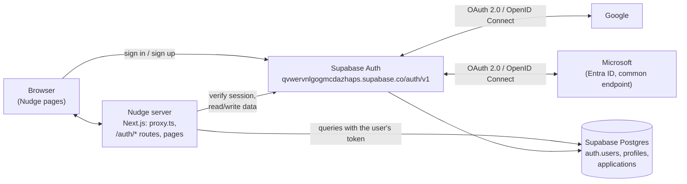
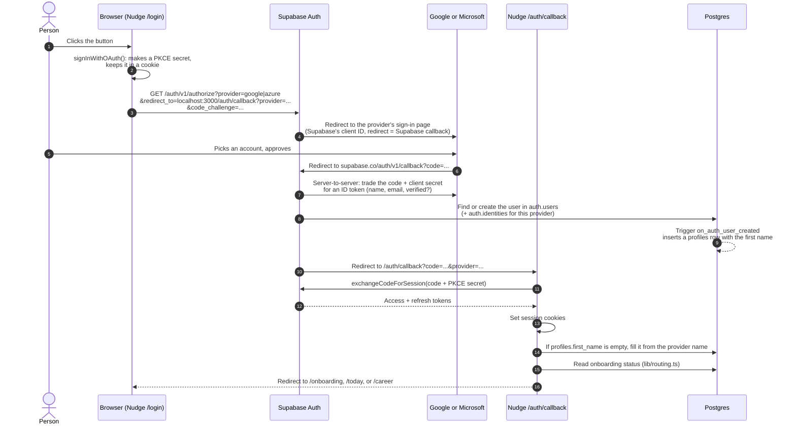
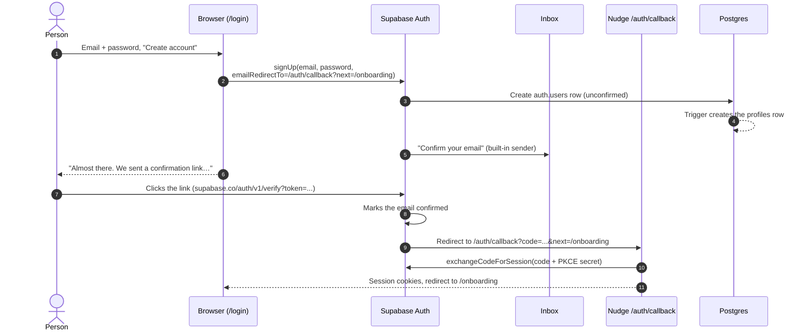

# How sign-in works

This doc explains how Nudge signs people in, how the app talks to Supabase, and how Supabase talks to Google and Microsoft. For the one-time dashboard setup, see [SETUP.md](../SETUP.md).

> The diagrams are Mermaid. They render on GitHub. In VS Code, install the "Markdown Preview Mermaid Support" extension to see them in the preview.

---

## The pieces



| Piece | Its job | Secrets it holds |
|---|---|---|
| **Nudge (this app)** | Shows the screens, starts sign-in, finishes it in `/auth/callback`, and decides where people go next. | None. Only the public Supabase URL and anon/publishable key (`.env.local`). |
| **Supabase Auth** | The actual login system. It stores users, checks passwords, sends emails, talks to Google and Microsoft, and issues session tokens. | The Google client secret and the Microsoft client secret (entered in the dashboard). |
| **Supabase Postgres** | Stores `auth.users` (managed by Supabase) and our `profiles` and `applications` tables. Row Level Security decides who can see which rows. | n/a |
| **Google / Microsoft** | Prove who the person is and hand Supabase their name and email. They never talk to Nudge directly. | n/a |

The key idea is that **Nudge never sees a password or a Google/Microsoft token.** Supabase does all of that. Nudge only receives a Supabase session at the end.

---

## Sessions: what "signed in" means

When sign-in succeeds, Supabase issues two tokens:

- **Access token:** a signed JWT that lasts about an hour. It contains the user's id (`sub`), email, and role `authenticated`.
- **Refresh token:** used to get a new access token when the old one expires.

`@supabase/ssr` stores both in **cookies** named `sb-qvwervnlgogmcdazhaps-auth-token` (split into `.0`, `.1` parts when large). Cookies, rather than browser storage, are what let the server pages know who is signed in.

Three places read that session:

| Where | File | What it does |
|---|---|---|
| **Every request** | [proxy.ts](../proxy.ts) → [lib/supabase/proxy.ts](../lib/supabase/proxy.ts) | Calls `getClaims()`, which checks the JWT and refreshes it if it's about to expire, writing fresh cookies. If you're signed out and the path is a signed-in screen, it redirects to `/login`. (Next 16 calls middleware "proxy".) |
| **Server pages and actions** | [lib/supabase/server.ts](../lib/supabase/server.ts), [lib/auth.ts](../lib/auth.ts) | `requireUser()` calls `getUser()`, which asks Supabase Auth to confirm the session is real, then redirects to `/login` if not. |
| **Browser code** | [lib/supabase/client.ts](../lib/supabase/client.ts) | Used by the login screen and the reset-password form to start sign-in. |

A new server client is created for every request, so one person's session is never reused for another.

---

## Flow 1: "Continue with Google" / "Sign in with Microsoft"

Both buttons use the same flow, **OAuth 2.0 with PKCE**. Supabase sits in the middle.



What each step guards against:

- **Two redirect checks.** Google/Microsoft only send the person back to the **Supabase callback URL** registered with them (step 6). Supabase only sends them on to an address on its **Redirect URLs allow-list** (step 10). Nobody can bounce a sign-in to their own site.
- **PKCE (steps 2 and 11).** The one-time `code` is useless without the secret that only this browser holds, so a code leaked in a URL or log can't be used by someone else.
- **Client secrets stay in Supabase (step 7).** The Google and Microsoft secrets live only in the Supabase dashboard, never in Nudge's code or `.env.local`.

Code: [components/auth/LoginScreen.tsx](../components/auth/LoginScreen.tsx) (`signInWith`), [app/auth/callback/route.ts](../app/auth/callback/route.ts).

### Supabase ↔ Google

| Setting | Where | Value |
|---|---|---|
| OAuth client (Web application) | Google Cloud → Google Auth Platform → Clients | Client ID + secret, pasted into Supabase → Providers → Google |
| Authorized redirect URI | same client | `https://qvwervnlgogmcdazhaps.supabase.co/auth/v1/callback` |
| Authorized JavaScript origin | same client | `http://localhost:3000` (plus production later) |
| Scopes | consent screen | `openid`, `email`, `profile` (basic, no Google review needed) |

Google returns `given_name`, `name`, `email`, and `email_verified`. Supabase saves them in `auth.users.raw_user_meta_data`, and our trigger copies the first name into `profiles.first_name`.

While the Google app is in **Testing** mode, only listed test users can sign in. Publish it when you're ready for anyone.

### Supabase ↔ Microsoft

Supabase calls Microsoft's provider **"Azure"**, which is why the code says `provider: "azure"`.

| Setting | Where | Value |
|---|---|---|
| App registration | Azure portal → Entra ID → App registrations | Application (client) ID |
| Supported account types | same | Multitenant **+ personal Microsoft accounts**, i.e. the `common` endpoint |
| Redirect URI (Web) | same | `https://qvwervnlgogmcdazhaps.supabase.co/auth/v1/callback` |
| Client secret | Certificates & secrets | The **Value**, pasted into Supabase. **It expires.** See SETUP.md §6. |
| Optional claims (ID token) | Token configuration | `email`, `xms_edov` |
| Azure Tenant URL in Supabase | Providers → Azure | **Empty** = `common` (any work/school tenant + Outlook.com) |
| Scope requested by Nudge | `LoginScreen.tsx` | `email`. Microsoft doesn't always send the email without it. |

Microsoft-specific behavior:

- **Verified email only.** Microsoft work/school accounts can have an email address that nobody has verified. The `xms_edov` claim tells Supabase whether the email's domain is verified, and Supabase refuses unverified ones. Without this, someone could create a tenant claiming your email and sign in as you.
- **"Need admin approval."** Some schools and companies only let employees sign in to apps an IT admin has approved. If the person cancels on that screen, Microsoft sends an error (codes like `AADSTS65001`, `AADSTS90094`) back through Supabase to `/auth/callback?error=...`. We turn that into the friendly `microsoft_blocked` message on `/login`, suggesting Google or email instead.
- **Back button.** If the person just presses Back on Microsoft's page, no callback happens at all. Before leaving, the login screen saves a small "went to Microsoft" note in `sessionStorage`. If the page is then reached via Back, it shows the same message. (This is the `PENDING_KEY` logic in `LoginScreen.tsx`.)

### Same email, different buttons

If someone signs up with email + password and later uses Google with the same (verified) address, Supabase **links** both to one user: one row in `auth.users`, two rows in `auth.identities`. They keep one profile and one set of applications.

---

## Flow 2: Create account with email



Details:

- **Passwords** are hashed and stored by Supabase. Nudge never stores them. The app asks for at least 8 characters.
- **"Email already in use."** With Confirm email on, Supabase doesn't reveal whether an address is registered, so that strangers can't probe for accounts. Instead it returns a user with no identities. The login screen detects that and shows "There's already an account with this email" with a **Log in** shortcut.
- **Same-browser rule.** The PKCE secret lives in the browser that signed up, so the link has to be opened there. If it's opened elsewhere, the email still gets confirmed, `/auth/callback` shows "link expired", and the person just logs in. Once custom SMTP is set up, the email templates can point at [`/auth/confirm`](../app/auth/confirm/route.ts) (`token_hash` links), which work in any browser. See SETUP.md §4.
- **The built-in email sender** only delivers to your Supabase team's addresses, a few per hour. Real users need custom SMTP.

## Flow 3: Log in with email

1. `signInWithPassword(email, password)` goes from the browser straight to Supabase Auth.
2. On success, the session cookies are set and the page does a full navigation to [`/auth/continue`](../app/auth/continue/route.ts).
3. `/auth/continue` asks [`lib/routing.ts`](../lib/routing.ts) where this person belongs and redirects there.

A wrong password shows "That email and password don't match", with a **Reset password** shortcut.

## Flow 4: Forgot password

1. "Forgot password?" calls `resetPasswordForEmail(email, redirectTo=/auth/callback?next=/auth/reset-password)`.
2. The screen always says "If there's an account for … a reset link is on its way", whether or not the account exists.
3. The emailed link signs the person in through `/auth/callback` and lands on [`/auth/reset-password`](../app/auth/reset-password/page.tsx).
4. They choose a new password (`updateUser({ password })`), then go to `/auth/continue`.

## Flow 5: Log out

The **Log out** button in the app nav is a form that `POST`s to [`/auth/signout`](../app/auth/signout/route.ts). That route calls `signOut()`, which clears the cookies and revokes the person's refresh tokens (signing them out everywhere), then redirects to `/login?notice=signed_out`. It's POST-only so that a link or a prefetch can't sign someone out by accident.

---

## After sign-in: where people go

| Who | Goes to | Enforced by |
|---|---|---|
| Signed out, on a signed-in screen | `/login` | `proxy.ts` (every request) and `requireUser()` |
| Signed in, on `/login` | Their destination (below) | `app/(auth)/login/page.tsx` |
| Signed in, onboarding not finished | `/onboarding`, at their saved step | `app/(app)/layout.tsx` |
| Signed in, onboarding finished, on `/onboarding` | Their destination | `app/onboarding/page.tsx` |
| Finished, chose "Settled in a job", 0 applications | `/career` | `lib/routing.ts` |
| Finished, everyone else | `/today` | `lib/routing.ts` |

Signed-in screens: `/onboarding`, `/today`, `/career`, `/search`, `/people`, `/ask`.

---

## How the database knows who you are

Every database call from Nudge carries the person's **access token**. Postgres reads it, and `auth.uid()` returns the id inside it. Row Level Security uses that on every query:

```sql
-- applications: a person can only see their own rows
create policy "applications: select own" on public.applications
  for select to authenticated using ((select auth.uid()) = user_id);
```

There are matching policies for insert, update, and delete, and the same four on `profiles` (matching `id`). In practice:

- `supabase.from("applications").select("*")` only ever returns **your** rows, even if the code forgot a `user_id` filter. (We still add the filter, as a second line of defense.)
- Signed-out requests (the `anon` role) have **no access** to these tables at all.
- The anon/publishable key in `.env.local` is safe to be public. On its own it grants nothing beyond what RLS allows.

Two pieces run with elevated rights, on purpose:

- **`handle_new_user()` trigger.** When Supabase Auth inserts a row into `auth.users`, this creates the matching `profiles` row and copies the first word of the name from the sign-up metadata (`given_name`, `full_name`, or `name`). It's `security definer` so it can write `profiles` on the new user's behalf, and nobody can call it through the API.
- **`/auth/callback` name fill.** If the trigger found no name, the callback fills `profiles.first_name` from the provider. It only does this when the field is empty, so it never overwrites a name the person typed.

Migrations: [supabase/migrations/](../supabase/migrations/). To check RLS by hand, use [supabase/verify_rls.sql](../supabase/verify_rls.sql).

---

## Friendly errors

Raw error codes never reach the screen. [lib/auth-messages.ts](../lib/auth-messages.ts) maps them:

| What happened | Comes in as | Shown as |
|---|---|---|
| Cancelled Google/Microsoft sign-in | `?error=access_denied` on `/auth/callback` | "Sign-in was cancelled. No problem…" |
| Microsoft admin approval / declined consent | `AADSTS65001`, `65004`, `90094`, `900941` | "…Some school and work accounts need an administrator's approval… Continuing with Google or with your email works just as well." |
| Expired or reused email link | code exchange / `verifyOtp` fails | "That link has expired or was already used." |
| Wrong password | `invalid_credentials` | "That email and password don't match…" |
| Email already registered | `user_already_exists` / empty identities | "There's already an account with this email…" |
| Too many attempts | `over_*_rate_limit`, HTTP 429 | "That's a lot of tries in a short time…" |
| Anything else | n/a | "Something went wrong on our side. Please try again." |

---

## What to maintain

| Thing | When | How |
|---|---|---|
| **Microsoft client secret** | Before it expires (date in SETUP.md §6) | Azure → Certificates & secrets → New secret → paste the Value into Supabase → delete the old one |
| **Redirect URLs** | When you add a domain (production, previews) | Supabase → Authentication → URL Configuration |
| **Google origins** | When you add a domain | Google Cloud → Clients → Authorized JavaScript origins |
| **Custom SMTP** | Before real users | Supabase → Authentication → Emails → SMTP Settings, then update the two templates (SETUP.md §4) |
| **Google publishing** | Before real users | Google Auth Platform → Audience → Publish app |

## Troubleshooting

| Symptom | Likely cause |
|---|---|
| Plain Supabase page saying "provider is not enabled" | That provider isn't switched on in Supabase → Sign In / Providers |
| Google: "redirect_uri_mismatch" | The Supabase callback URL isn't in the Google client's Authorized redirect URIs |
| Microsoft: "AADSTS50011 … redirect URI" | Same, for the Azure app registration |
| Microsoft sign-in suddenly stops working | The client secret expired |
| Sent to the Supabase Site URL instead of back to the app | `localhost:3000/**` (or your domain) is missing from Redirect URLs |
| Confirmation email never arrives | The built-in sender only mails team members, a few per hour. Set up custom SMTP |
| "That link has expired" right after clicking an email link | The link was opened in a different browser (PKCE). Log in normally; the email is confirmed |
| Signed in, but always sent back to `/onboarding` | `profiles.onboarding_completed_at` is still empty. Finish or skip setup |

## File map

```
proxy.ts                               refresh session on every request; signed-out redirect
lib/supabase/env.ts                    reads the two public env vars
lib/supabase/client.ts                 browser client
lib/supabase/server.ts                 server client (per request, cookie-backed)
lib/supabase/proxy.ts                  updateSession() used by proxy.ts
lib/auth.ts                            getUser(), requireUser()
lib/routing.ts                         destinationFor(): onboarding / today / career
lib/auth-messages.ts                   error + notice wording
components/auth/LoginScreen.tsx        the /login UI and all sign-in calls
components/auth/ProviderButtons.tsx    branded Google / Microsoft buttons
components/auth/ResetPasswordForm.tsx  new-password form
app/(auth)/login/page.tsx              /login (redirects signed-in people)
app/auth/callback/route.ts             OAuth + email links: code -> session
app/auth/confirm/route.ts              token_hash email links (after the template change)
app/auth/continue/route.ts             "send me where I belong"
app/auth/reset-password/page.tsx       choose a new password
app/auth/signout/route.ts              POST to log out
supabase/migrations/                   tables, trigger, RLS
```
