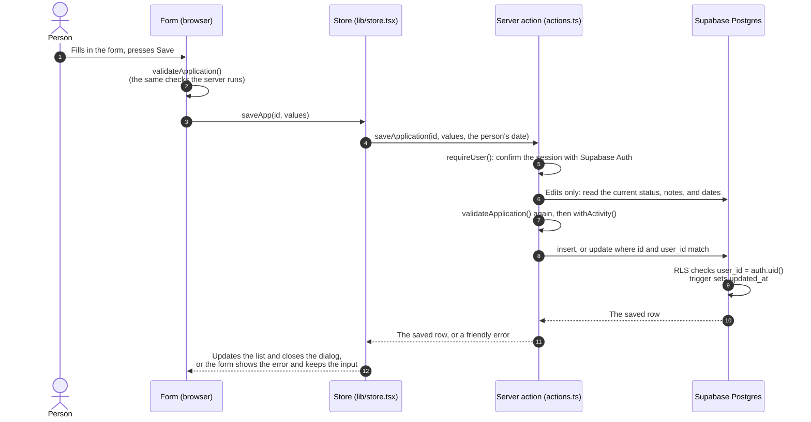

# How the application tracker works

This doc explains the **Job search → Applications** screen: where the data lives, what happens when someone adds or changes an application, and the rules behind statuses and dates. For sign-in, see [AUTH.md](AUTH.md). For the one-time database setup, see [SETUP.md](../SETUP.md).

> The diagram is Mermaid. It renders on GitHub. In VS Code, install the "Markdown Preview Mermaid Support" extension to see it in the preview.

---

## The pieces

| Piece | File | Its job |
|---|---|---|
| **Screen** | [app/(app)/search/page.tsx](../app/(app)/search/page.tsx) | Tabs, search, the status ring, the list, and the empty, loading, and error states |
| **Row** | [components/ApplicationRow.tsx](../components/ApplicationRow.tsx) | One application. Its status chip opens a menu to change the status or delete |
| **Form** | [components/ApplicationForm.tsx](../components/ApplicationForm.tsx) | Add and edit, inside the shared dialog ([FormDialog.tsx](../components/FormDialog.tsx)) |
| **Store** | [lib/store.tsx](../lib/store.tsx) | Keeps the list in the browser and sends every change to the server actions |
| **Server actions** | [app/(app)/search/actions.ts](../app/(app)/search/actions.ts) | Read and write `applications` on the server, as the signed-in person |
| **Rules** | [lib/services/applications.ts](../lib/services/applications.ts) | Statuses, "Needs a nudge", validation, date rules, and mapping rows to the UI. Pure functions: no UI, no database |
| **Table** | `public.applications` in Supabase | One row per application, protected by Row Level Security |

The store loads the list once, when the first signed-in screen opens (it lives in the app layout, [app/(app)/layout.tsx](../app/(app)/layout.tsx)), and keeps it current as changes save. Reloading the page loads it again.

---

## The data

### The `applications` table

| Column | Type | Notes |
|---|---|---|
| `id` | uuid | `gen_random_uuid()` |
| `user_id` | uuid | The owner. Defaults to `auth.uid()`. Deleting the user deletes their applications |
| `company` | text | Required. 1–200 characters after trimming |
| `role`, `location` | text | Up to 200 characters each |
| `status` | text | `Researching`, `Applied`, `Interviewing`, `Offer`, `Rejected`, or `Archived`. Defaults to `Applied` |
| `date_applied` | date | |
| `last_activity` | date | Set by the app. See [Dates](#dates) |
| `source` | text | Where the job was found, for example "Company site" or "Referral". Up to 120 |
| `posting_url` | text | Must start with `http://` or `https://`. Up to 2048 |
| `notes` | text | Up to 5000 |
| `created_at`, `updated_at` | timestamptz | A trigger keeps `updated_at` current |

Indexes on `(user_id, status)` and `(user_id, updated_at desc)` cover "my list by status" and "my list, newest changes first".

**Who can see what.** Row Level Security is on. A signed-in person can select, insert, update, and delete only rows where `user_id = auth.uid()`. Signed-out requests (`anon`) have no access to the table at all. The server actions also filter every query by `user_id`, as a second line of defense. No code uses the service role key. [AUTH.md](AUTH.md#how-the-database-knows-who-you-are) explains how the database knows who's asking, and [supabase/verify_rls.sql](../supabase/verify_rls.sql) checks it by hand.

### Statuses

Six statuses are stored. A seventh, **Needs a nudge**, is never stored. It's worked out from the dates whenever it's shown.

| Status | For |
|---|---|
| Researching | Saved but not applied yet. Onboarding calls it "Not applied yet" |
| Applied | Sent, waiting to hear back |
| Interviewing | In conversations |
| Offer | An offer came in |
| Rejected | An actual no |
| Archived | Moved on: no reply for weeks, the posting closed, or no longer interested. Hidden from the main list |

The form says it in one line: "Archived is for jobs you've moved on from. Rejected is for an actual no."

### Dates

"Needs a nudge" is worked out from `date_applied` and `last_activity`. The server sets them in `withActivity()`:

- **Date applied.** If the status is Applied and there's no date, it becomes today. Dates in the future are refused.
- **Last activity, new application.** Starts at the date applied, or today if there isn't one, so an old application added late doesn't look freshly active.
- **Last activity, changes.** Becomes today when the status changes or the notes change. Other edits leave it alone.
- **Never earlier than the date applied.** If it would be, it moves up to the date applied.

"Today" is the person's own date, sent by the browser. The server uses it if it's within two days of the server's date (UTC), and its own date otherwise. Without this, a save at 9 p.m. in Boston would be dated tomorrow.

### "Needs a nudge"

An application needs a nudge when it's **Applied** and its last activity (or, if that's empty, its date applied) was **7 or more days ago**. The 7 is `NUDGE_AFTER_DAYS` in [lib/services/applications.ts](../lib/services/applications.ts).

When it does, its chip says "Needs a nudge", the row gets a yellow edge, and it moves to the top of the list. Other Applied rows show when they'll need one ("Nudge on Nov 10"). The status ring counts them, and so does the badge on **Job search** in the nav.

Nothing is sent. Reminders aren't built yet, and there's no "I followed up" button. For now, editing the notes (for example, "Followed up Nov 3") resets the clock.

---

## What happens when you save



The server actions:

| Action | What it does |
|---|---|
| `listApplications()` | All of your rows, most recently updated first |
| `saveApplication(id, input, today)` | Adds (when `id` is null) or edits. Validates, applies the date rules, and returns the saved row |
| `setApplicationStatus(id, status, today)` | The quick status change from the chip. Same date rules |
| `deleteApplication(id)` | Deletes one row |

Each one starts with `requireUser()`, filters by `user_id`, and answers with either the data or a calm error message. Expected problems (bad input, a failed query, a row deleted in another tab) come back as messages, not crashes.

**Quick status changes** show the new status right away. If the save fails, the row switches back and a message appears above the list with **Try again**. **Deleting** takes two clicks ("Click again to delete"), in both the chip menu and the form.

---

## Validation

The form and the server both run `validateApplication()`, so problems show before anything is sent, and bad data can't get in another way. The database repeats the main limits as check constraints.

| Field | Rule |
|---|---|
| Company | Required. Up to 200 characters |
| Role, Location | Up to 200 |
| Source | Up to 120 |
| Notes | Up to 5000 |
| Status | One of the six |
| Date applied | A real date, not in the future |
| Posting link | Web links only. Without `http://` or `https://`, `https://` is added, so `careers.acme.com/123` works. Other kinds (`javascript:`, `mailto:`) are refused, and it needs a full domain name (with a dot). Up to 2048 |

Every value is trimmed, and empty optional fields are saved as `null`. Problems show under the field they belong to, and focus moves to the first one.

---

## The screen

- **Rows** show the company, role, location, date applied, the first two lines of the notes, and the status chip. Clicking a row, or its company name, opens the form.
- **The status chip** is a button. It opens a menu with the six statuses and **Delete application**. It works by tap, click, or keyboard: Enter or Space opens it, the arrow keys and Home/End move, and Esc closes it. Clicking outside also closes it.
- **Tabs:** Applications (everything except Archived), Target companies, and the archive icon (Archived only).
- **The status ring** counts applications by status. The ring leaves out Archived; the legend next to it includes it. Clicking a legend item filters the list, and clicking Archived opens the Archived tab.
- **Search** looks at company, role, and notes, ignoring case. It filters in the browser.
- **Order:** rows that need a nudge come first. The rest stay in the order they loaded (most recently updated first), with new ones added at the top.

### Empty, loading, and error states

| When | What shows |
|---|---|
| Loading | Three placeholder rows. Screen readers hear "Loading your applications" |
| The list didn't load | "Your applications are taking a moment" and **Try again** |
| No applications yet | "Your list is empty, for now" and **Add your first application** |
| Search finds nothing | "Nothing matches …" and **Clear search** |
| Nothing archived | "Nothing archived yet. Applications you archive show up here." |
| A status filter is empty | For example "Nothing in Offer right now." and **Show all** |
| Everything is archived | "Everything here is archived. Add a new application when you're ready." |
| A save fails | The form stays open with everything typed, plus a message and **Try again** |
| A status change or delete fails | A message above the list with **Try again** and **Dismiss** |

**Add application** stays disabled until the list has loaded.

---

## Where applications come from

1. **Job search → Add application.**
2. **Onboarding step 3**, "Add the jobs you've already applied to." People paste links or add jobs by hand, then set a status and roughly when they applied: this week (today), last week (10 days ago, so it needs a nudge right away), or earlier (21 days ago). Leaving the step (Continue, Add N applications, or a swipe) saves them with `addOnboardingJobs()` in [app/onboarding/actions.ts](../app/onboarding/actions.ts). Their last activity starts at the date applied. Jobs still missing a company aren't saved and stay on the step.
3. **Onboarding step 4**, "Keep your tracker up to date automatically," previews two ways to add jobs from email. Both are marked **Coming soon** and can't be selected. **Continue to Nudge** finishes onboarding.

**Skip setup** at the top of onboarding finishes it without saving jobs that weren't added yet.

The **Today** and **Career** pages read the same table on the server and show a simple read-only list ([components/SavedApplications.tsx](../components/SavedApplications.tsx)) until those screens are built.

---

## Not built yet

- **Reminders.** Nothing is emailed or notified. [app/api/cron/reminders/route.ts](../app/api/cron/reminders/route.ts) is a stub.
- **Adding jobs from email.** Only the Coming soon cards on onboarding step 4.
- **Paging.** The whole list loads at once. Supabase returns at most 1,000 rows per request by default, so someone with more than that would need paging.
- **Target companies** live in the browser only. They start empty and aren't saved.
- **`/api/applications`** ([route.ts](../app/api/applications/route.ts)) is an unused stub from the scaffold. The tracker uses server actions instead.

The **Fill in** button next to the posting link reads the company, role, and location from the link's text through `/api/prefill`. It never fetches the page, and the tracker work didn't change it.

---

## Changing things

| To | Change |
|---|---|
| Change when "Needs a nudge" starts | `NUDGE_AFTER_DAYS` in `lib/services/applications.ts` |
| Change a length limit | `LIMITS` in `lib/services/applications.ts`, and the matching check constraint in a new migration |
| Add or rename a status | A migration for `applications_status_check`; `Status` in `lib/types.ts`; `ApplicationStatus` in `lib/supabase/database.types.ts`; `STATUSES` (with a color token from `app/globals.css`) in `lib/services/applications.ts`; and `ROW_STATUSES` in `lib/onboarding.ts` if onboarding should offer it |
| Add a field | A migration; `ApplicationRow` in `database.types.ts`; `Application` in `lib/types.ts`; `ApplicationInput`, `CleanApplication`, `validateApplication()`, `toApplication()`, and `toInput()` in `lib/services/applications.ts`; `setApplicationStatus()` in `actions.ts`; `FIELDS` in `components/ApplicationForm.tsx`; and the row, if it should show there |

`database.types.ts` is written by hand to match the migrations. Once the Supabase CLI is linked, it can be generated instead (the command is at the top of the file).

---

## Migrations

| File | What it does |
|---|---|
| `20261103000000_profiles_applications.sql` | Creates `profiles` and `applications`, the sign-up trigger, and Row Level Security |
| `20261103010000_tighten_grants.sql` | Removes permissions the app doesn't use |
| `20261103020000_applications_tracker.sql` | Reshapes `applications` for the tracker: text statuses, `date_applied`, `last_activity`, a free-text `source`, the link check, and the two indexes. Also allows a 4th onboarding step |

All three are applied to the Supabase project as of 2026-11-03. For a new project, run them in order in the SQL Editor (SETUP.md §2). Supabase's migration history doesn't match these file names, because some were run in the SQL Editor, so `supabase db push` won't line up with this project until the history is repaired (`supabase migration repair`).

The SQL Editor warns before running the third file ("destructive operations" and "UPDATE without a WHERE clause"). Both are expected: it replaces the old status and source types, an index, and a check, and fills `last_activity` on every existing row.

---

## Troubleshooting

| Symptom | Likely cause |
|---|---|
| Every save says "We couldn't save that just now" | The third migration hasn't run (the app writes `date_applied` and `last_activity`), or Supabase can't be reached. Supabase → Logs shows the error |
| The list never loads ("Your applications are taking a moment") | Supabase can't be reached, or the values in `.env.local` are wrong |
| A status change jumps back with a message | That save failed. Press **Try again** |
| "That application isn't in your list anymore" | It was deleted in another tab or on another device |
| An application seems to be missing | It's Archived (open the archive tab), a status filter is on, or the search box isn't empty |

---

## File map

```
app/(app)/search/page.tsx          the Job search screen: tabs, search, ring, list, states
app/(app)/search/actions.ts        server actions: list, save, set status, delete
components/ApplicationRow.tsx      one row, and the status and delete menu
components/ApplicationForm.tsx     the add/edit form
components/FormDialog.tsx          the dialog; sends applications to ApplicationForm
components/charts/StatusRing.tsx   the ring and its clickable legend
components/SavedApplications.tsx   read-only list on Today and Career
lib/store.tsx                      loads the list; saves through the server actions
lib/services/applications.ts       statuses, nudge rule, validation, date rules, mapping
lib/types.ts                       Application and Status, as the UI sees them
lib/supabase/database.types.ts     table row types (hand-written)
lib/onboarding.ts                  onboarding job rows -> applications (cleanRows)
app/onboarding/actions.ts          addOnboardingJobs(), finishOnboarding()
supabase/migrations/               the table, its checks and indexes, and RLS
supabase/verify_rls.sql            check that people can't see each other's rows
```
